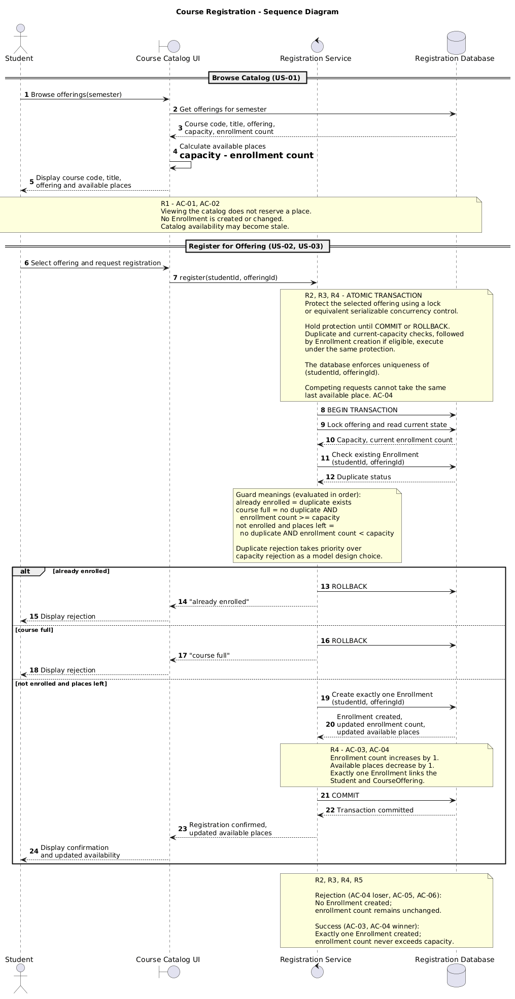
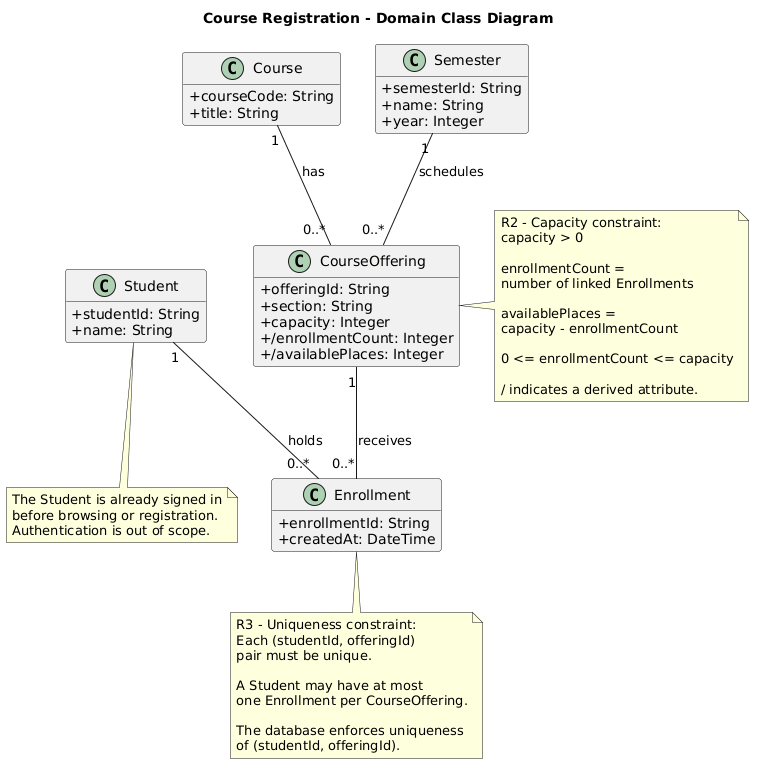
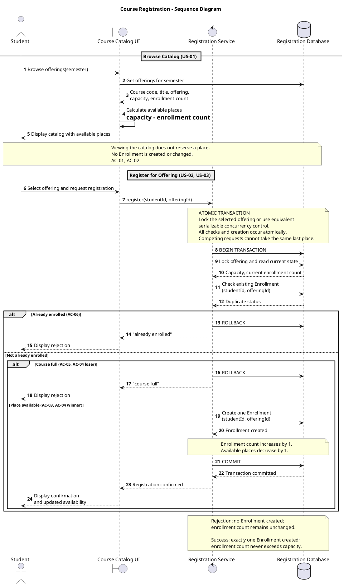
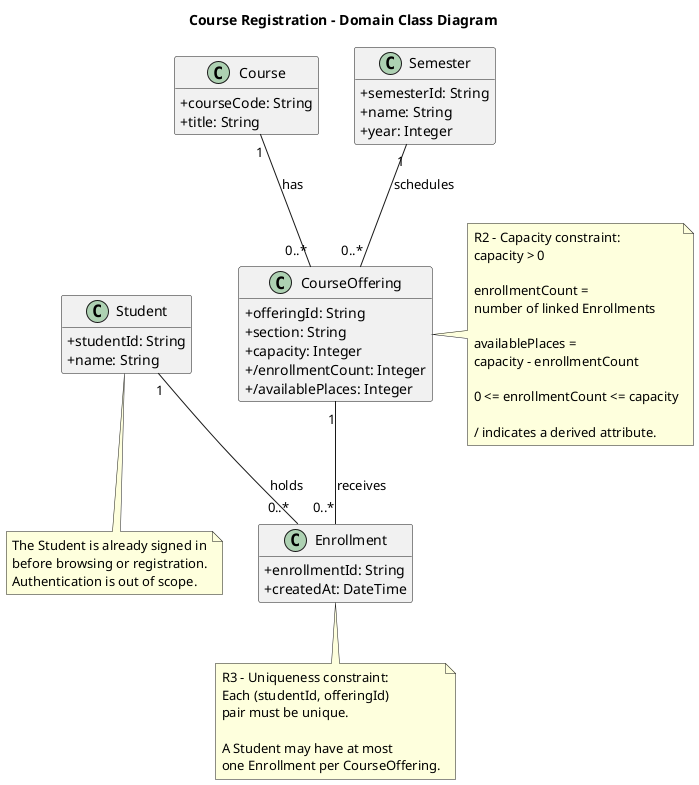
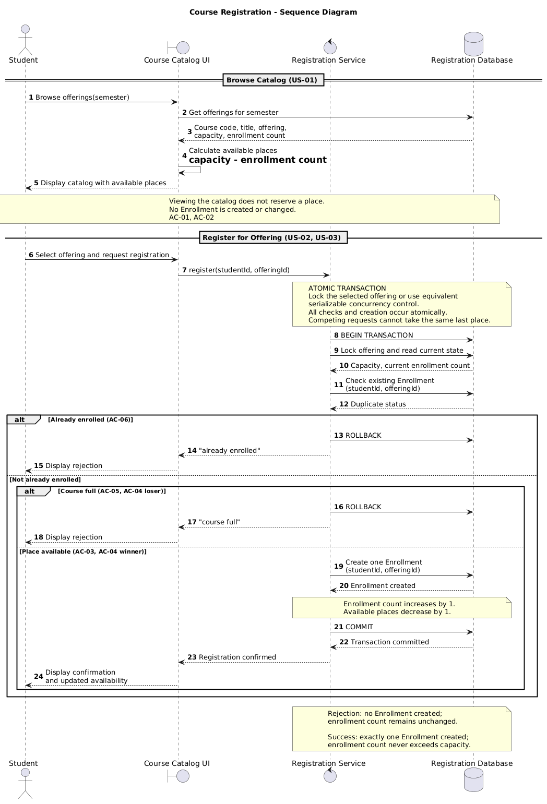
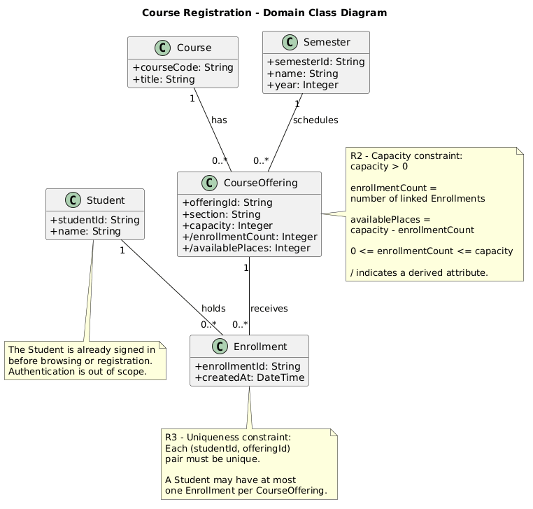

# SIS #02 — AI-Assisted UML Modeling: University Course Registration

<!--
  This is the only file you write your report in. README.md tells you what goes where.

  Rules the checker relies on:
  - Do not delete, rename or renumber the ## headings, the ### headings, or the **Label:** words.
  - Replace every "(write here)" and "(paste here)". None may be left when you submit.
  - Comments like this one are ignored by the checker and the word counter. Delete them or leave them.
-->

## 1. Scope and assumptions

<!-- Your FINAL scope statement and assumptions, after reviewing Prompt A's output. Say here
     what is out of scope (payments, prerequisites, timetable clashes, waiting lists,
     cancellation) — section 2 must not mention them. Section 10 keeps your first version. -->

**Scope:** The system allows signed-in university students to browse course offerings for a semester and register for a specific offering. It displays course information and available places, checks capacity and duplicate enrollments, and returns either a registration confirmation or a clear rejection message. Payments, prerequisites, timetable clashes, waiting lists, and cancellation are outside the scope.

**Assumptions:**

1. The system stores Enrollment records in a database and calculates available places by subtracting the current enrollment count from the offering capacity.
2. The system performs duplicate checks, capacity checks, and Enrollment creation atomically to prevent competing requests from exceeding the available capacity.

## 2. User stories and acceptance criteria

<!-- Your APPROVED requirements: Prompt A's draft after your review. Keep the IDs, the three
     story headings and the bullet shape. Every criterion names the rule(s) it maps to,
     e.g. (R2, R4). Two criteria per story. Nothing out of scope.
     Format of a criterion, on one bullet:
     - **AC-03** (R2, R4): Given ..., When ..., Then ... -->

### US-01 — Browse offerings

**US-01:** As a student, I want to browse the electronic course catalog for a semester so that I can view course offerings and their available places before requesting registration.

- **AC-01** (R?): Given student Alice is signed in and the Fall 2026 catalog contains CS101 — Introduction to Programming, Offering A, with a capacity of 30 and 25 enrollments, When Alice browses the catalog, Then the system displays the course code, title, offering, and 5 available places. Rules: R1.
- **AC-02** (R?): Given Alice views CS101 Offering A with 5 available places, When she views the offering without requesting registration, Then no Enrollment is created and the enrollment count and available places remain unchanged. Rules: R1, R2.

### US-02 — Register for an offering

**US-02:** As a student, I want to register for a specific course offering so that I can secure one available place and receive confirmation of my enrollment.


- **AC-03** (R?): Given Bob is signed in, CS102 Offering B has a capacity of 20 and 19 enrollments, and Bob is not already enrolled, When Bob requests registration, Then the system rechecks availability, creates exactly one Enrollment linking Bob to Offering B, increases the count to 20, updates available places to 0, and returns confirmation.Rules: R2, R3, R4.
- **AC-04** (R?): Given CS102 Offering B has exactly one available place and neither Bob nor Alice is enrolled, When both submit competing registration requests, Then the final checks and Enrollment creation occur atomically, exactly one request succeeds and creates one Enrollment, the other receives "course full" without creating an Enrollment, and the count increases by exactly one without exceeding capacity.Rules: R2, R4, R5.

### US-03 — Receive a clear rejection

**US-03:** As a student, I want the system to reject registration requests when an offering is full or I am already enrolled so that I receive a clear explanation without creating duplicate or excess enrollments.

- **AC-05** (R?): Given Charlie is signed in and CS103 Offering C has a capacity of 25 with 25 existing enrollments, When Charlie requests registration, Then the system rejects the request with "course full", creates no Enrollment, and leaves the count unchanged at 25.Rules: R2, R5.
- **AC-06** (R?): Given Alice already has one Enrollment in CS101 Offering A, When Alice requests registration for the same offering again, Then the system rejects the request with "already enrolled", creates no additional Enrollment, and leaves the enrollment count unchanged.Rules: R3, R5.

## 3. Sequence diagram

<!-- The FINAL diagram, rendered. Change .png to .svg if that is what you exported. -->



**Participants:** The sequence diagram has four participants. Student is a signed-in university student who browses the catalog and requests registration. Course Catalog UI displays course information, receives registration requests, and shows confirmations or rejection messages. Registration Service checks registration rules and controls the registration process. Registration Database stores enrollment information and supports transactions

**Atomic operation:** The atomic operation starts with BEGIN TRANSACTION. The Registration Service locks the selected offering and reads its current capacity and enrollment count. It then checks whether the student already has an Enrollment for that offering. If the student is not enrolled and places are available, the system creates exactly one Enrollment and commits the transaction. Otherwise, the transaction is rolled back. The lock or equivalent protection is held until COMMIT or ROLLBACK, preventing two students from taking the same last place. Browsing the catalog does not reserve a place because it only reads and displays information without creating an Enrollment.

**Where the Enrollment is created:** The Enrollment is created in the else not enrolled and places left branch. The Registration Service sends the message Create exactly one Enrollment(studentId, offeringId) to the Registration Database. This creates an instance of the Enrollment class shown in Section 4. The new record connects one Student to one CourseOffering.

**Technical lifelines:** Course Catalog UI, Registration Service, and Registration Database are technical lifelines that do not appear as domain classes in the class diagram. Course Catalog UI represents the interface, Registration Service represents the registration logic, and Registration Database represents data storage and transaction handling. This difference is acceptable because the sequence diagram shows how the system works, while the class diagram describes the main domain objects and their relationships.

## 4. Class diagram

<!-- The FINAL diagram, rendered. -->



<!-- One row per association in classes.puml, read in both directions. -->

| Association | Read left to right | Read right to left |
| --- | -- | -- |
| Course — CourseOffering | One Course can have zero or many CourseOfferings. | Each CourseOffering belongs to exactly one Course. |
| Semester — CourseOffering | One Semester can have zero or many CourseOfferings. | Each CourseOffering belongs to exactly one Semester. |
| Student — Enrollment | One Student can have zero or many Enrollments. | Each Enrollment belongs to exactly one Student. |
| CourseOffering — Enrollment | One CourseOffering can have zero or many Enrollments. | Each Enrollment belongs to exactly one CourseOffering. |
**How an Enrollment links a student to an offering:** Enrollment represents the registration of one Student in one CourseOffering. Each Enrollment is connected to exactly one Student and exactly one CourseOffering. A student can have multiple Enrollments for different offerings, but cannot have two Enrollments for the same offering.

**Capacity constraint:** The number of Enrollments for an offering must satisfy 0 <= enrollmentCount <= capacity, and capacity must be greater than zero. Available places are calculated as capacity - enrollmentCount. Multiplicity alone cannot express this rule because the maximum number of Enrollments depends on the capacity value of each CourseOffering.

**Uniqueness constraint:** Each (studentId, offeringId) pair must be unique. This means a student cannot register twice for the same offering. Multiplicity alone cannot express this because it does not prevent two Enrollment objects from linking the same Student and CourseOffering. The registration process and database uniqueness constraint prevent duplicates.

## 5. Traceability

<!-- Every rule, including the catalog fields and availability (R1). Column 1: the rule and
     the criteria that cover it, e.g. "R2 + AC-03, AC-04". Column 2: the message, guard,
     class or constraint that shows the rule in YOUR diagrams. Column 3: the T-ID that
     exercises it, or the extra check you did instead (R1 has no T case). -->

| Rule and acceptance criteria | Model evidence | Validation evidence |
| --- | --- | --- |
| R1 — AC-01, AC-02 | Sequence: Browse Catalog, Display course code, title, offering and available places. Class: Course, CourseOffering, Semester. | T3 — The catalog view can become stale, and registration uses current availability. |
| R2 — AC-02, AC-03, AC-04, AC-05 | Sequence: BEGIN TRANSACTION, Lock offering and read current state, course full guard. Class: enrollmentCount cannot exceed capacity. | T1, T2, T3 — Registration respects capacity and rejects a full offering. |
| R3 — AC-03, AC-06 | Sequence: Check existing Enrollment and already enrolled guard. Class: uniqueness of studentId and offeringId. | T4 — Duplicate registration is rejected without creating an Enrollment. |
| R4 — AC-03, AC-04 | Sequence: Create exactly one Enrollment, COMMIT, Registration confirmed. Class: Student and CourseOffering associations with Enrollment. | T1, T2 — Successful registration creates one Enrollment and updates availability. |
| R5 — AC-04, AC-05, AC-06 | Sequence: course full and already enrolled branches execute ROLLBACK without creating Enrollment. | T3, T4 — Rejected registrations leave the count unchanged. |
## 6. Walkthroughs

<!-- Walk each case through YOUR final sequence diagram, message by message. Column 2: the
     actual steps and the state change (count before → after). Column 3 starts with Pass or
     Fail, then the location: the message, guard or note where you saw it. A Fail you
     report honestly is a finding, not a penalty. -->

| Case | Observed path and state change | Judgment and evidence |
| --- | --- | --- |
| T1. Available | Capacity = 2, count 0 → 1. Student requests registration → UI calls `register(studentId, offeringId)` → RS begins transaction → DB locks offering and returns current count → duplicate check returns false → `else not enrolled and places left` creates exactly one Enrollment → COMMIT → confirmation. Available places: 2 → 1. | Pass — In `models/sequence.puml`, the `else not enrolled and places left` guard, `Create exactly one Enrollment` message, and `COMMIT` show the successful registration. The count becomes 1 without exceeding capacity. |
| T2. Last place | Capacity = 2, count 1 → 2. Student requests registration → transaction begins → offering is locked and current count is read → duplicate check returns false → `else not enrolled and places left` creates one Enrollment → COMMIT → confirmation with updated availability. Available places: 1 → 0. | Pass — The `Lock offering and read current state` message, `else not enrolled and places left` guard, and `COMMIT` show that the last place is allocated atomically. The count reaches capacity but does not exceed it. |
| T3. Full | Capacity = 2, count 2 → 2. Earlier catalog view showed one free place, but it did not reserve it. Student requests registration → transaction begins → DB returns the current count of 2 → duplicate check returns false → `else course full` executes ROLLBACK → UI displays "course full". Available places remain 0. | Pass — The catalog note states that availability may become stale. The `Lock offering and read current state` message and `else course full` guard lead to `ROLLBACK`, with no Enrollment creation and no count change. |
| T4. Duplicate | Capacity = 2, count 1 → 1. An already-enrolled student requests the same offering → transaction begins → offering is locked → `Check existing Enrollment(studentId, offeringId)` returns duplicate status true → `alt already enrolled` executes ROLLBACK → UI displays "already enrolled". Available places remain 1. | Pass — The `Check existing Enrollment` message and `alt already enrolled` guard lead directly to `ROLLBACK` and the "already enrolled" response. No additional Enrollment is created, and the count remains 1. |

## 7. Review decisions

<!-- At least three substantive decisions about Prompt C's critique or your own inspection.
     Decision: accepted / rejected / modified — and what you did. Reason: why, in a full
     sentence. Rule: R1–R5. Do not invent an error to fill the table; a justified rejection
     of advice counts. -->

| AI suggestion or model element | Decision | Reason | Rule |
| --- | --- | --- | --- |
| Sequence diagram guards | modified | I will make the duplicate and capacity conditions more explicit while keeping the required PlantUML format without square brackets. | R2, R3 |
| Return updated availability after successful registration | accepted | The confirmation should clearly reflect the updated number of available places after creating an Enrollment. | R4 |
| Clarify atomic transaction and locking | accepted) | The lock must protect the final checks and Enrollment creation until commit or rollback to prevent overbooking. | R2, R4 |

## 8. Modeling explanation

<!-- 200–300 words. Your main design choices; how the class diagram and the sequence diagram
     complement each other; why an activity diagram could also help explain the workflow. -->

In this assignment, I created two UML diagrams for a university course registration system. The sequence diagram shows how the student and the system communicate during browsing and registration. It has four participants: Student, Course Catalog UI, Registration Service, and Registration Database.

First, the student opens the course catalog and sees the available offerings. The system displays the course code, title, offering, and number of free places. At this stage, no enrollment is created because browsing does not reserve a place.

When the student requests registration, the Registration Service starts a database transaction. The system checks if the student is already enrolled and if the offering still has free places. These checks are important because the number of available places can change after the student views the catalog. If registration is possible, the system creates one Enrollment and confirms the registration. Otherwise, it returns "course full" or "already enrolled" without changing the enrollment count.

The class diagram shows the main objects in the system. Course represents a subject, while CourseOffering represents a specific section in a semester. Student represents the person registering, and Enrollment connects the student to the selected offering. I also kept the Semester class because it helps organize offerings by semester.

The system has two important rules. The enrollment count cannot be higher than capacity, and a student cannot register twice for the same offering. These rules help keep registration data correct.

## 9. Reflection

<!-- 150–200 words. Written by you, not by the assistant: where AI helped, one decision you
     made yourself, one remaining limitation. Specific beats flattering. -->

During this assignment, I learned how AI can help with creating requirements and UML diagrams. At first, I used AI to generate three user stories and six acceptance criteria. After checking them, I used AI to create a sequence diagram and a class diagram.

The diagrams looked correct, but I understood that I should not trust every AI answer without checking it. In Prompt C, AI suggested several improvements. For example, the registration conditions could be clearer, and the successful response could show the updated number of available places.

I accepted some suggestions and rejected others. I decided to keep the original participants instead of adding another service because it was not necessary. I also kept the Semester class because it was useful for the system.

One important thing I learned is why atomic transactions matter. Without proper checks, two students could register for the same last available place.

This assignment showed me that AI is a useful tool, but I still need to understand the requirements, review its answers, and make my own decisions.

## 10. Appendix A — Before AI

<!-- Written BEFORE you run Prompt A, committed and pushed in your first commit, and never
     edited afterwards. This is what you paste into Prompt A as "My initial assumptions". -->

**Scope:** The system allows university students to browse available courses, select a specific course offering, and register for it. It checks available places and duplicate registrations before creating an enrollment. The system confirms successful registrations or explains why a request was rejected. Payments, prerequisites, timetable conflicts, waiting lists, and cancellations are outside the scope

**Initial assumptions:**

1. The system stores enrollment records in a database and calculates available places using the offering capacity and current enrollment count.
2. When multiple students request the last available place simultaneously, the system processes the final registration checks and enrollment creation atomically to prevent overbooking.

## 11. Appendix B — AI exchanges

<!-- Complete prompts and complete responses, as text — never screenshots. Paste each inside
     the ~~~~ block that follows its label: AI responses contain ``` PlantUML blocks, and
     ~~~~ keeps them from breaking this file. Prompts B and C: the prompt text first, then
     the material it refers to ("below", "these two") pasted under it, in the same block.
     You may add B5, B6 … after B4 if you ran more. -->

### B1 — Requirements (Prompt A)

- **Tool:** ChatGPT
- **Model:** GPT-6.1 Sol
- **Date:** 2026-10-18
- **Purpose:** draft 3 user stories and 6 acceptance criteria

<!-- Model: the exact model with its version, as the tool shows it (e.g. "GPT-5 Thinking",
     "Claude Sonnet 4.5"). If the tool does not show it, write: not displayed
     Date: YYYY-MM-DD -->

**Prompt:**

~~~~text
Act as a requirements analyst. Use only this course registration scenario and rules R1–R5: A student browses an electronic course catalog, chooses a course offering and requests registration. Each offering has a limited number of places. A Course describes a subject. A CourseOffering is one scheduled section in one semester. Registration always targets a specific offering. Assume that the student is signed in, the selected offering exists, and its capacity is a positive whole number.

R1. Catalog: Show the course code, title, offering and available places for one semester.
R2. Capacity: Recheck current availability when registering. Enrollment must never exceed the offering's capacity.
R3. Duplicates: A student may have at most one enrollment in the same offering. Reject a repeat request.
R4. Success: Create exactly one Enrollment linking the student and offering, update availability and return a confirmation.
R5. Rejection: Explain "course full" or "already enrolled". Create no enrollment and leave the enrollment count unchanged.

A catalog view does not reserve a place. Model the final checks and enrollment creation as one atomic operation, so competing requests cannot take the same last place. A note describing it is enough. Out of scope: payments, prerequisites, timetable clashes, waiting lists, cancellation. Use fictional students and courses. Treat any extra AI suggestion as a proposal you accept or reject explicitly. My initial assumptions are 1. The system stores enrollment records in a database and calculates available places using the offering capacity and current enrollment count. 2. The system processes final registration checks and enrollment creation atomically when students request the last available place.

Draft 3 user stories and 2 Given / When / Then acceptance criteria for each. Use IDs US-01 to US-03 and AC-01 to AC-06. Map each criterion to rule IDs.

Cover normal and rejection behavior. List uncertainty separately. Do not add excluded features or invent university policies.
~~~~

**Response:**

~~~~text
Course Registration System — User Stories and Acceptance Criteria
1. Initial assumptions
ID	Assumption	Status
A-01	The system stores Enrollment records in a database and calculates available places as the offering capacity minus the current enrollment count.	Accepted
A-02	The system performs final registration checks and enrollment creation atomically, preventing competing requests from taking the same last place.	Accepted
Both assumptions are consistent with rules R1–R5.
2. User stories
US-01 — Browse Course Catalog
User story:
As a student, I want to browse the electronic course catalog for a semester so that I can view course offerings and their available places before requesting registration.
AC-01 — Display course information
Given student Alice is signed in and the catalog contains CS101 — Introduction to Programming, Offering A, in the Fall 2026 semester, with a capacity of 30 and 25 enrollments,
When Alice browses the Fall 2026 course catalog,
Then the system displays the course code (CS101), title (Introduction to Programming), offering (A), and 5 available places.
Rule mapping: R1
AC-02 — Catalog viewing does not reserve a place
Given Alice views CS101, Offering A, which has 5 available places,
When Alice views the offering without submitting a registration request,
Then the system does not create an Enrollment, and the enrollment count and available places remain unchanged.
Rule mapping: R1, R2 (catalog viewing and registration availability distinction)
US-02 — Register for an Available Course Offering
User story:
As a student, I want to register for a specific course offering so that I can secure one available place and receive confirmation of my enrollment.
AC-03 — Successful registration
Given student Bob is signed in, CS102 Offering B has a capacity of 20 and 19 existing enrollments, and Bob is not enrolled in that offering,
When Bob requests registration for CS102 Offering B,
Then the system rechecks availability, creates exactly one Enrollment linking Bob to Offering B, increases the enrollment count to 20, updates available places to 0, and returns a registration confirmation.
Rule mapping: R2, R3, R4
AC-04 — Competing requests for the last place
Given CS102 Offering B has exactly one available place, and neither Bob nor Alice is enrolled in it,
When Bob and Alice submit competing registration requests for that last place,
Then the system processes the final checks and enrollment creation atomically, exactly one request succeeds, exactly one Enrollment is created, and the other request is rejected with "course full". The enrollment count increases by exactly 1 and never exceeds capacity.
Rule mapping: R2, R4, R5
US-03 — Prevent Invalid Registrations
User story:
As a student, I want the system to reject registration requests when an offering is full or I am already enrolled so that I receive a clear explanation without creating duplicate or excess enrollments.
AC-05 — Reject registration when course is full
Given student Charlie is signed in, CS103 Offering C has a capacity of 25 and 25 existing enrollments, and Charlie is not enrolled in it,
When Charlie requests registration for CS103 Offering C,
Then the system rejects the request with "course full", creates no Enrollment, and leaves the enrollment count unchanged at 25.
Rule mapping: R2, R5
AC-06 — Reject duplicate registration
Given Alice already has one Enrollment in CS101 Offering A,
When Alice submits another registration request for the same offering,
Then the system rejects the request with "already enrolled", creates no additional Enrollment, and leaves the enrollment count unchanged.
Rule mapping: R3, R5
3. Requirements traceability matrix
Acceptance criterion	R1	R2	R3	R4	R5
AC-01 — Display catalog	✓				
AC-02 — No reservation on viewing	✓	✓			
AC-03 — Successful registration		✓	✓	✓	
AC-04 — Competing requests		✓		✓	✓
AC-05 — Course full		✓			✓
AC-06 — Duplicate enrollment			✓		✓
All five rules are covered, including normal registration, duplicate rejection, full-capacity rejection, and competing requests.
4. Atomic operation note
The system must perform the duplicate-enrollment check, current-capacity check, and Enrollment creation as one atomic database operation.
For example, when Bob and Alice request the last available place simultaneously, only one registration can succeed. The other must receive "course full". This ensures that enrollment never exceeds capacity.
The catalog view does not reserve a place, so availability may change between browsing and registration.
5. Uncertainties
ID	Uncertainty	Treatment
U-01	If a student is already enrolled in an offering that is also full, which rejection message should take priority?	Unresolved. R3 and R5 require duplicate rejection, while R2 and R5 cover full offerings. No priority is specified.
U-02	Must the catalog display availability from a fresh database calculation on every view?	Unresolved. R1 requires available places to be shown, while R2 explicitly requires rechecking at registration.
U-03	What information must the registration confirmation contain beyond confirming success?	Unresolved. R4 requires a confirmation but does not define its format.
These uncertainties do not prevent drafting the acceptance criteria and should not be treated as additional university policies.
6. AI suggestions and decisions
Proposal	Decision	Reason
Calculate availability as capacity minus current enrollment count.	Accepted	Matches initial assumption A-01 and supports R1 and R2.
Use an atomic transaction for final registration checks and Enrollment creation.	Accepted	Matches A-02 and prevents over-enrollment under R2.
Specify a priority between "already enrolled" and "course full" when both apply.	Rejected for now	The scenario does not define a priority. Retained as uncertainty U-01.
Add waiting lists or automatic course recommendations.	Rejected	Outside the defined scope.
Conclusion: The three user stories and six acceptance criteria address catalog browsing, successful enrollment, full-capacity rejection, duplicate rejection, and concurrent registration. They follow R1–R5 without introducing additional university policies or excluded features.
~~~~

### B2 — UML drafts (Prompt B)

- **Tool:** ChatGPT
- **Model:** GPT-6.1 Sol
- **Date:** 2026-10-18
- **Purpose:** draft the sequence and class diagrams

**Prompt:**

~~~~text
Using my approved scenario, R1–R5, stories and criteria below, return separate PlantUML code blocks for a sequence diagram and a domain class diagram.
Sequence: include catalog browsing and guarded success, full-course and duplicate outcomes. Model final checks and creation as one atomic operation.
Class: show domain concepts, useful attributes and multiplicities. State the capacity and uniqueness constraints. Explain assumptions and any technical lifelines.

Approved scenario:
A signed-in university student browses an electronic course catalog for one semester, selects a specific course offering and requests registration. Each offering has a limited capacity. A Course describes a subject, while a CourseOffering represents one scheduled section in one semester. The selected offering exists and its capacity is a positive integer. Viewing the catalog does not reserve a place. Final duplicate and capacity checks and Enrollment creation must be atomic.

R1 — Catalog: Display course code, title, offering and available places for one semester.
R2 — Capacity: Recheck current availability during registration. Enrollment must never exceed capacity.
R3 — Duplicates: Reject repeated registration in the same offering.
R4 — Success: Create exactly one Enrollment linking the student and offering, update available places and return confirmation.
R5 — Rejection: Return "course full" or "already enrolled" without creating an Enrollment or changing the count.

Out of scope: payments, prerequisites, timetable clashes, waiting lists and cancellation.

Approved user stories and acceptance criteria:

US-01 — Browse offerings
As a student, I want to browse the electronic course catalog for a semester so that I can view course offerings and their available places before requesting registration.

AC-01 (R1): Given Alice is signed in and the Fall 2026 catalog contains CS101, Introduction to Programming, Offering A, with capacity 30 and 25 enrollments, When Alice browses the catalog, Then the system displays the code, title, offering and 5 available places.

AC-02 (R1, R2): Given Alice views CS101 Offering A with 5 available places, When she views the offering without requesting registration, Then no Enrollment is created and availability remains unchanged.

US-02 — Register for an offering
As a student, I want to register for a specific course offering so that I can secure one available place and receive confirmation.

AC-03 (R2, R3, R4): Given Bob is signed in, CS102 Offering B has capacity 20 and 19 enrollments, and Bob is not enrolled, When Bob requests registration, Then the system rechecks availability, creates exactly one Enrollment linking Bob to Offering B, updates the count to 20 and available places to 0, and confirms registration.

AC-04 (R2, R4, R5): Given CS102 Offering B has exactly one available place, and neither Bob nor Alice is enrolled, When both submit competing requests, Then the final checks and Enrollment creation happen atomically, only one request succeeds, one Enrollment is created, the other receives "course full", and capacity is never exceeded.

US-03 — Receive a clear rejection
As a student, I want invalid registrations rejected with a clear explanation without creating duplicate or excess enrollments.

AC-05 (R2, R5): Given Charlie is signed in and CS103 Offering C has capacity 25 and 25 enrollments, When Charlie requests registration, Then the system returns "course full", creates no Enrollment, and leaves the count at 25.

AC-06 (R3, R5): Given Alice is already enrolled in CS101 Offering A, When Alice requests registration for that offering again, Then the system returns "already enrolled", creates no additional Enrollment, and leaves the enrollment count unchanged.
~~~~

**Response:**

~~~~text
Below are two separate PlantUML diagrams based strictly on your approved scenario, R1–R5, US-01–US-03, and AC-01–AC-06.
1. Sequence Diagram — Course Registration
This diagram includes catalog browsing, registration, duplicate rejection, full-course rejection, successful enrollment, and atomic processing of competing requests.

@startuml
title Course Registration - Sequence Diagram

autonumber

actor Student
boundary "Course Catalog UI" as UI
control "Registration Service" as RS
database "Registration Database" as DB

== Browse Catalog (US-01) ==

Student -> UI: Browse offerings(semester)
UI -> DB: Get offerings for semester
DB --> UI: Course code, title, offering,\ncapacity, enrollment count
UI -> UI: Calculate available places\n= capacity - enrollment count
UI --> Student: Display catalog with available places

note over Student, DB
Viewing the catalog does not reserve a place.
No Enrollment is created or changed.
AC-01, AC-02
end note

== Register for Offering (US-02, US-03) ==

Student -> UI: Select offering and request registration
UI -> RS: register(studentId, offeringId)

note over RS, DB
ATOMIC TRANSACTION
Lock the selected offering or use equivalent
serializable concurrency control.
All checks and creation occur atomically.
Competing requests cannot take the same last place.
end note

RS -> DB: BEGIN TRANSACTION
RS -> DB: Lock offering and read current state
DB --> RS: Capacity, current enrollment count

RS -> DB: Check existing Enrollment\n(studentId, offeringId)
DB --> RS: Duplicate status

alt Already enrolled (AC-06)
    RS -> DB: ROLLBACK
    RS --> UI: "already enrolled"
    UI --> Student: Display rejection

else Not already enrolled
    alt Course full (AC-05, AC-04 loser)
        RS -> DB: ROLLBACK
        RS --> UI: "course full"
        UI --> Student: Display rejection

    else Place available (AC-03, AC-04 winner)
        RS -> DB: Create one Enrollment\n(studentId, offeringId)
        DB --> RS: Enrollment created

        note over RS, DB
        Enrollment count increases by 1.
        Available places decrease by 1.
        end note

        RS -> DB: COMMIT
        DB --> RS: Transaction committed

        RS --> UI: Registration confirmed
        UI --> Student: Display confirmation\nand updated availability
    end
end

note over RS, DB
Rejection: no Enrollment created;
enrollment count remains unchanged.

Success: exactly one Enrollment created;
enrollment count never exceeds capacity.
end note

@enduml


Sequence diagram explanation
- US-01: The student browses the catalog for one semester and sees the course code, title, offering, and available places. Browsing does not create an enrollment.
- US-02: Registration targets a specific CourseOffering. The system rechecks the current count inside an atomic transaction.
- US-03: The system checks for an existing enrollment first. If one exists, it returns "already enrolled". Otherwise, if capacity is reached, it returns "course full".
- AC-04: Competing requests for the last available place are serialized by the transaction's locking or equivalent concurrency control. Only one can succeed.
The transaction begins before the final checks and commits only after successful Enrollment creation. A rejection rolls back without changing the enrollment count.
2. Domain Class Diagram — Course Registration
This diagram contains the domain concepts Student, Course, CourseOffering, Semester, and Enrollment, with attributes, multiplicities, and constraints.

@startuml
title Course Registration - Domain Class Diagram

skinparam classAttributeIconSize 0
hide methods

class Student {
    +studentId: String
    +name: String
}

class Course {
    +courseCode: String
    +title: String
}

class Semester {
    +semesterId: String
    +name: String
    +year: Integer
}

class CourseOffering {
    +offeringId: String
    +section: String
    +capacity: Integer
    +/enrollmentCount: Integer
    +/availablePlaces: Integer
}

class Enrollment {
    +enrollmentId: String
    +createdAt: DateTime
}

Course "1" -- "0..*" CourseOffering : has
Semester "1" -- "0..*" CourseOffering : schedules

Student "1" -- "0..*" Enrollment : holds
CourseOffering "1" -- "0..*" Enrollment : receives

note right of CourseOffering
R2 - Capacity constraint:
capacity > 0

enrollmentCount =
number of linked Enrollments

availablePlaces =
capacity - enrollmentCount

0 <= enrollmentCount <= capacity

/ indicates a derived attribute.
end note

note bottom of Enrollment
R3 - Uniqueness constraint:
Each (studentId, offeringId)
pair must be unique.

A Student may have at most
one Enrollment per CourseOffering.
end note

note bottom of Student
The Student is already signed in
before browsing or registration.
Authentication is out of scope.
end note

@enduml


Class diagram explanation
Class	Responsibility
Student	Represents the signed-in university student.
Course	Describes a subject using its course code and title.
CourseOffering	Represents one scheduled section of a Course in a particular Semester.
Semester	Identifies the academic semester used to browse offerings.
Enrollment	Records the registration relationship between one Student and one CourseOffering.
Multiplicities and constraints
- One Course can have zero or many CourseOffering objects; each offering belongs to exactly one Course.
- One Semester can contain zero or many offerings; each offering belongs to exactly one Semester.
- One Student can have zero or many enrollments; each Enrollment belongs to exactly one Student.
- One CourseOffering can receive zero or many enrollments; each Enrollment refers to exactly one offering.
Capacity invariant (R2):
\[
0 \leq \text{enrollmentCount} \leq \text{capacity}
\]

\[
\text{availablePlaces} = \text{capacity} - \text{enrollmentCount}
\]

Uniqueness invariant (R3):
\[
\operatorname{unique}(\text{studentId},\text{offeringId})
\]

These invariants must hold after every completed registration operation. A database uniqueness constraint on (studentId, offeringId) provides an additional safeguard against duplicates.
3. Assumptions and technical lifelines
Assumptions: The student is already authenticated, the selected offering exists, and its capacity is a positive integer. Availability is derived from the number of existing Enrollments rather than maintained as an independent domain attribute. Duplicate checking takes priority over capacity checking, so an already-enrolled student receives "already enrolled" even if the offering is full.
Technical lifelines: Course Catalog UI is a boundary component that handles student interaction. Registration Service is a control component responsible for registration rules and atomic transaction coordination. Registration Database stores the domain objects and enforces persistence and transaction consistency. These are technical participants in the sequence diagram, not additional domain classes.
Concurrency assumption: A transaction locks the selected offering before reading the current enrollment count and checking for duplicates. The lock remains effective until commit or rollback. An equivalent concurrency-control mechanism is also acceptable if it guarantees the same atomic behavior.
Scope: Payments, prerequisites, timetable clashes, waiting lists, and cancellation are intentionally excluded.
Together, the diagrams cover R1–R5, US-01–US-03, and AC-01–AC-06, including the one-place concurrency case in AC-04.
~~~~

### B3 — Model critique (Prompt C)

- **Tool:** ChatGPT
- **Model:** GPT-6.1 Sol
- **Date:** 2026-10-18
- **Purpose:** review both models against R1–R5 and T1–T4

**Prompt:**

~~~~text
Review these two UML models against R1–R5 and my acceptance criteria. Check message order, guards, state changes, multiplicities and naming.
Inspect the four validation cases: available places, exactly one place, full course after a stale catalog view, and duplicate registration.
For each issue, cite the affected rule and model element. Explain the impact and propose a focused correction. Separate genuine defects from optional design choices.

Rules R1–R5:

R1 — Catalog: Show course code, title, offering and
available places for one semester.

R2 — Capacity: Recheck current availability at registration.
Enrollment must never exceed capacity.

R3 — Duplicates: At most one Enrollment per student
per offering. Reject repeat requests.

R4 — Success: Create exactly one Enrollment linking
the student and offering, update availability and confirm.

R5 — Rejection: Return "course full" or "already enrolled".
Create no Enrollment and leave the count unchanged.

Acceptance criteria:
**AC-01** (R?): Given student Alice is signed in and the Fall 2026 catalog contains CS101 — Introduction to Programming, Offering A, with a capacity of 30 and 25 enrollments, When Alice browses the catalog, Then the system displays the course code, title, offering, and 5 available places.
- **AC-02** (R?): Given Alice views CS101 Offering A with 5 available places, When she views the offering without requesting registration, Then no Enrollment is created and the enrollment count and available places remain unchanged.
 **AC-03** (R?): Given Bob is signed in, CS102 Offering B has a capacity of 20 and 19 enrollments, and Bob is not already enrolled, When Bob requests registration, Then the system rechecks availability, creates exactly one Enrollment linking Bob to Offering B, increases the count to 20, updates available places to 0, and returns confirmation.
- **AC-04** (R?): Given CS102 Offering B has exactly one available place and neither Bob nor Alice is enrolled, When both submit competing registration requests, Then the final checks and Enrollment creation occur atomically, exactly one request succeeds and creates one Enrollment, the other receives "course full" without creating an Enrollment, and the count increases by exactly one without exceeding capacity.
 **AC-05** (R?): Given Charlie is signed in and CS103 Offering C has a capacity of 25 with 25 existing enrollments, When Charlie requests registration, Then the system rejects the request with "course full", creates no Enrollment, and leaves the count unchanged at 25.
- **AC-06** (R?): Given Alice already has one Enrollment in CS101 Offering A, When Alice requests registration for the same offering again, Then the system rejects the request with "already enrolled", creates no additional Enrollment, and leaves the enrollment count unchanged.


Original Sequence Diagram:

@startuml
title Course Registration - Sequence Diagram

autonumber

actor Student
boundary "Course Catalog UI" as UI
control "Registration Service" as RS
database "Registration Database" as DB

== Browse Catalog (US-01) ==

Student -> UI: Browse offerings(semester)
UI -> DB: Get offerings for semester
DB --> UI: Course code, title, offering,\ncapacity, enrollment count
UI -> UI: Calculate available places\n= capacity - enrollment count
UI --> Student: Display catalog with available places

note over Student, DB
Viewing the catalog does not reserve a place.
No Enrollment is created or changed.
AC-01, AC-02
end note

== Register for Offering (US-02, US-03) ==

Student -> UI: Select offering and request registration
UI -> RS: register(studentId, offeringId)

note over RS, DB
ATOMIC TRANSACTION
Lock the selected offering or use equivalent
serializable concurrency control.
All checks and creation occur atomically.
Competing requests cannot take the same last place.
end note

RS -> DB: BEGIN TRANSACTION
RS -> DB: Lock offering and read current state
DB --> RS: Capacity, current enrollment count

RS -> DB: Check existing Enrollment\n(studentId, offeringId)
DB --> RS: Duplicate status

alt Already enrolled (AC-06)
    RS -> DB: ROLLBACK
    RS --> UI: "already enrolled"
    UI --> Student: Display rejection

else Not already enrolled
    alt Course full (AC-05, AC-04 loser)
        RS -> DB: ROLLBACK
        RS --> UI: "course full"
        UI --> Student: Display rejection

    else Place available (AC-03, AC-04 winner)
        RS -> DB: Create one Enrollment\n(studentId, offeringId)
        DB --> RS: Enrollment created

        note over RS, DB
        Enrollment count increases by 1.
        Available places decrease by 1.
        end note

        RS -> DB: COMMIT
        DB --> RS: Transaction committed

        RS --> UI: Registration confirmed
        UI --> Student: Display confirmation\nand updated availability
    end
end

note over RS, DB
Rejection: no Enrollment created;
enrollment count remains unchanged.

Success: exactly one Enrollment created;
enrollment count never exceeds capacity.
end note

@enduml


Original Class Diagram:
@startuml
title Course Registration - Domain Class Diagram

skinparam classAttributeIconSize 0
hide methods

class Student {
    +studentId: String
    +name: String
}

class Course {
    +courseCode: String
    +title: String
}

class Semester {
    +semesterId: String
    +name: String
    +year: Integer
}

class CourseOffering {
    +offeringId: String
    +section: String
    +capacity: Integer
    +/enrollmentCount: Integer
    +/availablePlaces: Integer
}

class Enrollment {
    +enrollmentId: String
    +createdAt: DateTime
}

Course "1" -- "0..*" CourseOffering : has
Semester "1" -- "0..*" CourseOffering : schedules

Student "1" -- "0..*" Enrollment : holds
CourseOffering "1" -- "0..*" Enrollment : receives

note right of CourseOffering
R2 - Capacity constraint:
capacity > 0

enrollmentCount =
number of linked Enrollments

availablePlaces =
capacity - enrollmentCount

0 <= enrollmentCount <= capacity

/ indicates a derived attribute.
end note

note bottom of Enrollment
R3 - Uniqueness constraint:
Each (studentId, offeringId)
pair must be unique.

A Student may have at most
one Enrollment per CourseOffering.
end note

note bottom of Student
The Student is already signed in
before browsing or registration.
Authentication is out of scope.
end note

@enduml
~~~~

**Response:**

~~~~text
UML Model Review — Course Registration System
Overall: Pass with minor clarifications
Both UML models are largely consistent with R1–R5 and AC-01–AC-06. The sequence diagram correctly places the final duplicate and capacity checks inside a transaction, while the class diagram correctly represents the relationships, multiplicities, and constraints.
The main concern is that some required behavior is described in notes rather than explicitly represented in the sequence messages. There are also a few opportunities to make the guards and state changes more precise.
1. Requirements and acceptance criteria coverage
Acceptance criterion	Rule	Result
AC-01 — Catalog shows 5 places	R1	Pass
AC-02 — Browsing changes nothing	R1, R4	Pass
AC-03 — Last place registration	R2, R4	Pass
AC-04 — Competing requests	R2, R3, R4, R5	Pass, with concurrency assumption
AC-05 — Full course rejection	R2, R5	Pass
AC-06 — Duplicate rejection	R3, R5	Pass
AC-02 primarily verifies the read-only catalog behavior in R1. AC-04 also depends on R3's uniqueness invariant, although its specific scenario tests capacity contention rather than duplicate requests.
2. Genuine defects and specification gaps
Severity	Rule and model element	Issue and impact	Focused correction
Minor	R2, R3 — Sequence alt branches	The branches use readable conditions but do not explicitly state the predicates for duplicate and capacity decisions. The intended logic is understandable, but less directly testable.	Use [duplicateExists], [!duplicateExists and enrollmentCount >= capacity], and [!duplicateExists and enrollmentCount < capacity].
Minor	R4 — Sequence success response	Registration confirmed does not explicitly return the updated available-place value. The UI displays it, but the source is not shown.	Return enrollmentId, availablePlaces after commit, or explicitly query the updated availability.
Minor	R4 — Sequence Create one Enrollment	The count and availability changes appear only in a note. This is valid for derived attributes but does not explicitly connect the state transition to the database result.	Return newEnrollmentCount or availablePlaces from the successful creation operation.
Minor	R2, R3 — Sequence transaction note	Atomicity is declared, but its correctness depends on the actual locking or serializable implementation.	State that the selected offering is locked until commit/rollback and that uniqueness is enforced atomically.
These are primarily model precision and traceability gaps, rather than demonstrated violations of the rules. The original sequence already expresses the correct transaction order.
One further technical point: if the database implements the enrollment count using a stored counter, the successful transaction must update that counter consistently with Enrollment creation. If the count is calculated from linked Enrollment records, no separate counter update is necessary.
3. Sequence diagram review
Message order
The registration messages appear in the correct order:
1. Begin transaction.
2. Lock offering and read current capacity and enrollment count.
3. Check whether the student is already enrolled.
4. Reject a duplicate or full offering.
5. Create exactly one Enrollment when eligible.
6. Commit the transaction.
7. Return confirmation and updated availability.

This ordering supports R2–R5. In particular, the final capacity check happens after obtaining the lock, not when the catalog was browsed.
Guard review
Original guard	Suggested explicit guard
Already enrolled	[duplicateExists]
Not already enrolled	[!duplicateExists]
Course full	[enrollmentCount >= capacity]
Place available	[enrollmentCount < capacity]
Because the full and available branches are nested inside the nonduplicate branch, the original logic is correct.
Atomicity
The transaction is appropriately structured. To satisfy AC-04, the implementation must serialize conflicting registrations for the same offering and hold the required protection until commit or rollback.
The database should also enforce uniqueness of (studentId, offeringId) to protect R3. A transaction lock alone does not necessarily guarantee that uniqueness across every possible insertion path.
4. Class diagram review
Multiplicities
Relationship	Multiplicity	Evaluation
Course → CourseOffering	1 to 0..*	Correct
Semester → CourseOffering	1 to 0..*	Correct
Student → Enrollment	1 to 0..*	Correct
CourseOffering → Enrollment	1 to 0..*	Correct
Each Enrollment is associated with exactly one Student and one CourseOffering. A Student can have multiple Enrollments, and an offering can receive multiple Enrollments.
The multiplicity 0..* on the CourseOffering–Enrollment association is not a defect. UML multiplicity alone cannot express a capacity-dependent maximum. The constraint enrollmentCount <= capacity provides that restriction.
Attributes and constraints
The class model correctly specifies:
\[
capacity>0
\]

\[
enrollmentCount=|\text{linked Enrollments}|
\]

\[
availablePlaces=capacity-enrollmentCount
\]

\[
0\le enrollmentCount\le capacity
\]

It also correctly requires each (studentId, offeringId) pair to be unique.
The / prefix on enrollmentCount and availablePlaces is appropriate UML notation for derived attributes.
No genuine class-diagram structural defect was identified.
5. Four validation cases

Case 1 — Available places (AC-01, AC-02)
Capacity = 30, count = 25, available = 5.
The catalog correctly displays five places. Browsing creates no Enrollment and changes no state. Pass.


Case 2 — Exactly one place (AC-03, AC-04)
Capacity = 20, count = 19.
A successful registration creates one Enrollment, raises the count to 20 and reduces availability to zero. Under the specified transaction locking, competing requests cannot both succeed. Pass.


Case 3 — Full course after a stale catalog view (AC-05, R2, R5)
The student may have seen available places earlier, but the current count equals capacity when registration occurs.
The transaction rechecks the current count, returns "course full" and leaves the count unchanged. Pass.


Case 4 — Duplicate registration (AC-06, R3, R5)
The student already has an Enrollment for the selected offering.
The duplicate check causes rollback, returns "already enrolled" and creates no additional Enrollment. Pass.


A useful detail: if an offering is both full and the student is already enrolled, the current sequence returns "already enrolled" because duplicate checking comes first. R1–R5 do not specify precedence, so this is a valid design choice.
6. Optional design choices — not defects
Model element	Optional improvement	Reason
UI -> DB catalog query	Route through a Catalog Service	Cleaner architectural separation, but not required
BEGIN, COMMIT, ROLLBACK	Use a single registerAtomically() operation	Higher-level abstraction; current detail is valid
Semester class	Keep as a separate domain entity	Already appropriate for semester-specific offerings
Enrollment.createdAt	Retain or omit	Useful audit attribute, not required by R1–R5
Student.name	Retain or omit	Domain attribute outside the registration constraints
section versus offeringId	Clarify section as a human-readable label	Improves naming precision
Database lifeline	Keep as a technical participant	Appropriate for illustrating atomicity
There is no requirement to introduce payment, waitlist, prerequisite checking, cancellation, or other functionality.
7. Recommended minimal corrections
Rather than redesigning the models, I recommend these small changes to the sequence diagram:

alt duplicateExists
    RS -> DB: ROLLBACK
    RS --> UI: "already enrolled"
    UI --> Student: Display rejection
else !duplicateExists
    alt enrollmentCount >= capacity
        RS -> DB: ROLLBACK
        RS --> UI: "course full"
        UI --> Student: Display rejection
    else enrollmentCount < capacity
        RS -> DB: Create exactly one Enrollment\n(studentId, offeringId)
        DB --> RS: enrollmentId, newEnrollmentCount
        RS -> DB: COMMIT
        DB --> RS: Transaction committed
        RS --> UI: Registration confirmed,\nupdatedAvailablePlaces
        UI --> Student: Display confirmation\nand updated availability
    end
end


Keep the existing BEGIN TRANSACTION, lock/read and duplicate-check messages before this fragment, and retain the atomicity note.
For the class diagram, the only useful addition is a note clarifying that Enrollment uniqueness and capacity are persistent invariants enforced by the registration operation and database.
Final assessment
Sequence diagram
Meets R1–R5

Correct message order, rejection paths and transaction boundaries; minor improvements recommended for explicit guards and returned state.

Class diagram
Meets R1–R5

Correct domain concepts, relationships, multiplicities, derived attributes, capacity and uniqueness constraints.

Conclusion: The two original UML models are consistent with the approved scenario and acceptance criteria. No critical logical defect is evident. The proposed corrections improve clarity, verification and traceability without expanding the system scope.
~~~~

### B4 — Focused revision (Prompt D)

- **Tool:** ChatGPT
- **Model:** GPT-6.1 Sol
- **Date:** 2026-10-18
- **Purpose:** apply my accepted review decisions

**Prompt:**

~~~~text
Revise the UML sources using only my accepted review decisions: make sequence guards explicit without square brackets; return updated availability after successful enrollment; clarify atomic transaction and uniqueness enforcement; do not add a Catalog Service; retain Semester with a required `' why:` comment. Keep justified existing elements and explain each change.

Preserve the agreed scope and rule IDs. Return both updated PlantUML blocks and a concise change log. Flag any unresolved issue.

Approved requirements: the complete scenario, rules R1–R5, and US-01–US-03 with AC-01–AC-06 below. Original sources: the two complete PlantUML models below. My review decisions and evidence: the five decisions and their justifications below.

## 1. Approved scenario

A signed-in university student browses an electronic course catalog for one semester, selects a specific course offering, and requests registration.

A Course describes a subject, while a CourseOffering represents a specific section in a semester. The selected offering exists and has a positive integer capacity.

Browsing the catalog does not reserve places. Registration must recheck current capacity and duplicates. The final checks and Enrollment creation must execute atomically, preventing competing requests from exceeding capacity.

Out of scope: payments, prerequisites, timetable clashes, waiting lists, and cancellation.

## 2. Rules R1–R5

**R1 — Catalog:** Display course code, title, offering, and available places for one semester.

**R2 — Capacity:** Recheck current availability at registration. The enrollment count must never exceed the offering's capacity.

**R3 — Duplicates:** Prevent duplicate registration of the same student in the same offering.

**R4 — Successful enrollment:** Create exactly one Enrollment linking the student and offering, update available places, and return registration confirmation.

**R5 — Rejection:** Reject registration with "course full" or "already enrolled" without creating an Enrollment or changing the enrollment count.

## 3. Approved user stories and acceptance criteria

### US-01 — Browse offerings

**US-01:** As a student, I want to browse the electronic course catalog for a semester so that I can view course offerings and their available places before requesting registration.

- **AC-01** (R1): Given student Alice is signed in and the Fall 2026 catalog contains CS101 — Introduction to Programming, Offering A, with a capacity of 30 and 25 enrollments, When Alice browses the catalog, Then the system displays the course code, title, offering, and 5 available places.
- **AC-02** (R1, R2): Given Alice views CS101 Offering A with 5 available places, When she views the offering without requesting registration, Then no Enrollment is created and the enrollment count and available places remain unchanged.

### US-02 — Register for an offering

**US-02:** As a student, I want to register for a specific course offering so that I can secure one available place and receive confirmation of my enrollment.

- **AC-03** (R2, R3, R4): Given Bob is signed in, CS102 Offering B has a capacity of 20 and 19 enrollments, and Bob is not already enrolled, When Bob requests registration, Then the system rechecks availability, creates exactly one Enrollment linking Bob to Offering B, increases the count to 20, updates available places to 0, and returns confirmation.
- **AC-04** (R2, R4, R5): Given CS102 Offering B has exactly one available place and neither Bob nor Alice is enrolled, When both submit competing registration requests, Then the final checks and Enrollment creation occur atomically, exactly one request succeeds and creates one Enrollment, the other receives "course full" without creating an Enrollment, and the count increases by exactly one without exceeding capacity.

### US-03 — Receive a clear rejection

**US-03:** As a student, I want the system to reject registration requests when an offering is full or I am already enrolled so that I receive a clear explanation without creating duplicate or excess enrollments.

- **AC-05** (R2, R5): Given Charlie is signed in and CS103 Offering C has a capacity of 25 with 25 existing enrollments, When Charlie requests registration, Then the system rejects the request with "course full", creates no Enrollment, and leaves the count unchanged at 25.
- **AC-06** (R3, R5): Given Alice already has one Enrollment in CS101 Offering A, When Alice requests registration for the same offering again, Then the system rejects the request with "already enrolled", creates no additional Enrollment, and leaves the enrollment count unchanged.

## 4. Original Sequence Diagram — Prompt B

The following is the original AI-generated source. Use it as the starting point. Do not introduce changes other than those justified by my review decisions.



## 5. Original Domain Class Diagram — Prompt B



## 6. My review decisions and evidence — Section 7

These decisions were made after evaluating Prompt C's critical review of the original UML models.

**Decision 1 — MODIFY: Sequence diagram guards**

Affected elements: `alt` and `else` branches.

Rules: R2, R3, R5.

The original nested branches are logically valid, but the conditions should be more precise. Make the three registration outcomes directly visible in one `alt` structure using exactly these three guard labels:

- `alt already enrolled`
- `else course full`
- `else not enrolled and places left`

Do not enclose the guard labels in square brackets. Explain the boolean meaning of each condition using notes or nearby comments where helpful.

Duplicate registration should be rejected before capacity rejection, preserving the original behavior. Note that this priority is a model-level design choice rather than an explicit university policy.

**Decision 2 — ACCEPT: Return updated availability**

Affected element: the successful registration response from the Registration Service to the UI.

Rule: R4.

After creating an Enrollment and committing the transaction, the Registration Service should return registration confirmation and the updated available-place count. This makes the resulting state explicit and supports AC-03.

**Decision 3 — ACCEPT: Clarify atomic transaction and locking**

Affected elements: transaction note, database locking message, final checks, Enrollment creation, commit, and rollback.

Rules: R2, R3, R4.

Clarify that the selected offering is protected by locking or equivalent serializable concurrency control until commit or rollback.

Both the duplicate check and current-capacity check must occur under this protection.

A successful registration creates exactly one Enrollment. A rejected registration must create no Enrollment and must not change the count.

The database must enforce uniqueness for each `(studentId, offeringId)` pair.

This addresses competing requests for the last available place in AC-04.

**Decision 4 — REJECT: Add a separate Catalog Service**

Affected elements: catalog browsing lifelines.

Rule: R1.

The original Course Catalog UI and Registration Database are sufficient to represent browsing for this assignment. Introducing an additional Catalog Service is not necessary and would add complexity without improving required behavior.

Retain the original technical lifelines.

**Decision 5 — MODIFY: Retain Semester and justify it**

Affected element: `Semester` class.

Rule: R1.

Retain the Semester class because CourseOffering represents a section belonging to a specific semester. This is consistent with semester-specific catalog browsing.

However, insert this exact PlantUML comment directly above the `class Semester` declaration:

`' why: Semester explicitly represents the academic term to which a CourseOffering belongs and supports semester-specific catalog browsing under R1.`

Retain the four mandatory domain classes: Student, Course, CourseOffering, and Enrollment.

Retain useful identifiers, attributes, multiplicities, the capacity invariant, and the uniqueness invariant.

## 7. Required final model properties

### Final Sequence Diagram

The corrected sequence must:

1. Declare all participants before message exchanges.
2. Show the student browsing offerings for one semester.
3. Show course code, course title, offering, and available places in the browsing response.
4. Avoid Enrollment creation during catalog browsing.
5. Show the student selecting a specific CourseOffering and requesting registration.
6. Recheck duplicate status and current capacity after beginning atomic registration processing.
7. Protect final checks and Enrollment creation through commit or rollback.
8. Use exactly three registration outcomes in a single PlantUML `alt` structure:
   - `alt already enrolled`
   - `else course full`
   - `else not enrolled and places left`
9. Ensure the duplicate and full-course branches have no persistent state changes.
10. Create exactly one Enrollment only in the successful branch.
11. Return confirmation and updated availability only after the successful transaction commits.
12. Include rule or acceptance-criterion references where useful.

### Final Class Diagram

The corrected class diagram must:

1. Contain Student, Course, CourseOffering, and Enrollment.
2. Retain the justified Semester class with the required `' why:` comment directly above its declaration.
3. Show appropriate identifiers and attributes.
4. State multiplicities on both association ends.
5. Ensure each Enrollment belongs to exactly one Student and exactly one CourseOffering.
6. Show that one Course can have many CourseOfferings.
7. Show that one Semester can have many CourseOfferings.
8. Preserve the capacity invariant: `0 <= enrollmentCount <= capacity`, with `capacity > 0`.
9. Preserve derived availability: `availablePlaces = capacity - enrollmentCount`.
10. Preserve uniqueness of `(studentId, offeringId)`.
11. Avoid introducing functionality outside the agreed scope.

## 8. Four validation cases

Verify that the revised diagrams support these specific cases:

**T1 — Available places:** Capacity = 2, enrollment count = 0, new student registers. Expected result: success, exactly one new Enrollment, final count = 1, available places = 1.

**T2 — Exactly one place:** Capacity = 2, enrollment count = 1, new student registers. Expected result: success, exactly one new Enrollment, final count = 2, available places = 0.

**T3 — Stale catalog view:** The catalog previously showed one available place, but at registration the offering has capacity = 2 and current count = 2. Expected result: "course full", no new Enrollment, count remains 2.

**T4 — Duplicate registration:** Capacity = 2, enrollment count = 1, and the requesting student already has an Enrollment in the offering. Expected result: "already enrolled", no additional Enrollment, count remains 1.

These cases must not introduce new features or alter R1–R5.

## 9. Required output

Return the following:

**A. Final Sequence Diagram**

One complete, syntactically valid PlantUML code block, starting with `@startuml` and ending with `@enduml`.

**B. Final Class Diagram**

One complete, syntactically valid PlantUML code block, starting with `@startuml` and ending with `@enduml`.

**C. Concise change log**

For each change, specify the affected model element, the review decision that justified it, and the applicable rule.

**D. Validation summary**

Explain whether T1, T2, T3, and T4 pass, with expected Enrollment counts and rejection messages.

**E. Unresolved issues**

Identify any genuine remaining uncertainty. Do not invent university policies or assume excluded features.

Do not modify the original diagrams conceptually beyond the approved review decisions. Do not add extra domain classes, unnecessary services, payment features, prerequisites, waiting lists, timetable conflicts, or cancellation functionality.
~~~~

**Response:**

~~~~text
A. Final Sequence Diagram
The revised sequence diagram preserves the original four lifelines, uses exactly three registration outcomes in one alt structure, and explicitly shows atomic registration, uniqueness enforcement, and updated availability after a successful commit.

@startuml
title Course Registration - Sequence Diagram

autonumber

actor Student
boundary "Course Catalog UI" as UI
control "Registration Service" as RS
database "Registration Database" as DB

== Browse Catalog (US-01) ==

Student -> UI: Browse offerings(semester)
UI -> DB: Get offerings for semester
DB --> UI: Course code, title, offering,\ncapacity, enrollment count
UI -> UI: Calculate available places\n= capacity - enrollment count
UI --> Student: Display course code, title,\noffering and available places

note over Student, DB
R1 - AC-01, AC-02
Viewing the catalog does not reserve a place.
No Enrollment is created or changed.
Catalog availability may become stale.
end note

== Register for Offering (US-02, US-03) ==

Student -> UI: Select offering and request registration
UI -> RS: register(studentId, offeringId)

note over RS, DB
R2, R3, R4 - ATOMIC TRANSACTION
Protect the selected offering using a lock
or equivalent serializable concurrency control.

Hold protection until COMMIT or ROLLBACK.
Duplicate and current-capacity checks, followed
by Enrollment creation if eligible, execute
under the same protection.

The database enforces uniqueness of
(studentId, offeringId).

Competing requests cannot take the same
last available place. AC-04
end note

RS -> DB: BEGIN TRANSACTION
RS -> DB: Lock offering and read current state
DB --> RS: Capacity, current enrollment count

RS -> DB: Check existing Enrollment\n(studentId, offeringId)
DB --> RS: Duplicate status

note over RS
Guard meanings (evaluated in order):
already enrolled = duplicate exists
course full = no duplicate AND
  enrollment count >= capacity
not enrolled and places left =
  no duplicate AND enrollment count < capacity

Duplicate rejection takes priority over
capacity rejection as a model design choice.
end note

alt already enrolled
    RS -> DB: ROLLBACK
    RS --> UI: "already enrolled"
    UI --> Student: Display rejection

else course full
    RS -> DB: ROLLBACK
    RS --> UI: "course full"
    UI --> Student: Display rejection

else not enrolled and places left
    RS -> DB: Create exactly one Enrollment\n(studentId, offeringId)
    DB --> RS: Enrollment created,\nupdated enrollment count,\nupdated available places

    note over RS, DB
    R4 - AC-03, AC-04
    Enrollment count increases by 1.
    Available places decrease by 1.
    Exactly one Enrollment links the
    Student and CourseOffering.
    end note

    RS -> DB: COMMIT
    DB --> RS: Transaction committed

    RS --> UI: Registration confirmed,\nupdated available places
    UI --> Student: Display confirmation\nand updated availability
end

note over RS, DB
R2, R3, R4, R5

Rejection (AC-04 loser, AC-05, AC-06):
No Enrollment created;
enrollment count remains unchanged.

Success (AC-03, AC-04 winner):
Exactly one Enrollment created;
enrollment count never exceeds capacity.
end note

@enduml


B. Final Domain Class Diagram
The class diagram retains all five original domain classes, every original association and multiplicity, and the capacity and uniqueness constraints. The required ' why: comment appears directly above class Semester.

@startuml
title Course Registration - Domain Class Diagram

skinparam classAttributeIconSize 0
hide methods

class Student {
    +studentId: String
    +name: String
}

class Course {
    +courseCode: String
    +title: String
}

' why: Semester explicitly represents the academic term to which a CourseOffering belongs and supports semester-specific catalog browsing under R1.
class Semester {
    +semesterId: String
    +name: String
    +year: Integer
}

class CourseOffering {
    +offeringId: String
    +section: String
    +capacity: Integer
    +/enrollmentCount: Integer
    +/availablePlaces: Integer
}

class Enrollment {
    +enrollmentId: String
    +createdAt: DateTime
}

Course "1" -- "0..*" CourseOffering : has
Semester "1" -- "0..*" CourseOffering : schedules

Student "1" -- "0..*" Enrollment : holds
CourseOffering "1" -- "0..*" Enrollment : receives

note right of CourseOffering
R2 - Capacity constraint:
capacity > 0

enrollmentCount =
number of linked Enrollments

availablePlaces =
capacity - enrollmentCount

0 <= enrollmentCount <= capacity

/ indicates a derived attribute.
end note

note bottom of Enrollment
R3 - Uniqueness constraint:
Each (studentId, offeringId)
pair must be unique.

A Student may have at most
one Enrollment per CourseOffering.

The database enforces uniqueness
of (studentId, offeringId).
end note

note bottom of Student
The Student is already signed in
before browsing or registration.
Authentication is out of scope.
end note

@enduml


C. Concise change log
Element	Review decision	Rule	Change and justification
Sequence alt / else guards	Decision 1 — Modify	R2, R3, R5	Replaced nested branches with exactly three outcomes: already enrolled, course full, not enrolled and places left. Added boolean explanations without square brackets.
Guard evaluation priority	Decision 1 — Modify	R3, R5	Preserved duplicate rejection before capacity rejection. Explicitly identified this precedence as a model-level design choice.
RS → UI success response	Decision 2 — Accept	R4	Added updated available places to the registration confirmation returned after commit, making AC-03's result explicit.
DB → RS successful creation response	Decision 2 — Accept	R4	Included updated enrollment count and available places so the state returned to the UI has an identified source.
Atomic transaction note and database messages	Decision 3 — Accept	R2, R3, R4	Clarified that concurrency protection spans both checks, creation, and commit/rollback.
Enrollment uniqueness note	Decision 3 — Accept	R3	Explicitly documented database enforcement of unique (studentId, offeringId) pairs.
Catalog lifelines	Decision 4 — Reject addition	R1	Retained the original UI → Database interaction; no Catalog Service was introduced.
Semester class	Decision 5 — Modify	R1	Retained Semester and inserted the exact required ' why: comment.
All existing domain attributes and multiplicities remain unchanged. The technical lifelines are also unchanged.
D. Validation summary
T1 — Available places
Pass

Starting count: 0 of 2. The student is not enrolled and there is capacity.
Final count
1 / 2

Available
1


Result: One Enrollment created; registration confirmed.

T2 — Exactly one place
Pass

Starting count: 1 of 2. One student registers for the last place.
Final count
2 / 2

Available
0


Result: One Enrollment created; registration confirmed.

T3 — Stale catalog view
Pass

The catalog previously showed one place, but the current count is 2 of 2.
Final count
2 / 2 — unchanged

"course full"

Result: No Enrollment created. Transaction rolled back.

T4 — Duplicate registration
Pass

Starting count: 1 of 2. The requesting student already has an Enrollment.
Final count
1 / 2 — unchanged

"already enrolled"

Result: No additional Enrollment created. Transaction rolled back.

These are logical validations against the specified UML behavior, not results from executing the PlantUML or a database implementation.
AC-04's competing-request outcome is also supported by the documented locking or equivalent serializable transaction control: only one request can claim the final place.
E. Unresolved issues
There are no unresolved requirements conflicts in the revised models. Two implementation-level details remain deliberately unspecified:
1. Concurrency mechanism: The diagram requires locking or equivalent serializable control, but does not select a particular database technology or locking implementation. That is sufficient for the approved assignment scope.
2. Duplicate-versus-full precedence: When a student is already enrolled in a full offering, the diagram returns "already enrolled" first. This follows your accepted review decision; it is not presented as an official university policy.
The final diagrams preserve R1–R5, US-01–US-03 and AC-01–AC-06 without adding new services or out-of-scope functionality.
~~~~

## 12. Appendix C — Original diagrams

<!-- The AI's first output from Prompt B, rendered unedited from models/original/. -->





## 13. Appendix D — References and source checks

### References

<!-- Full references, one per line, each starting with "- ". Only sources you actually opened.
     Every URL used in the source checks must also appear here. Example:
     - Sommerville, I. (2016). Software Engineering, 10th ed., Global Edition. Pearson. Ch. 5. -->

- ### References

- PlantUML. (n.d.). *Sequence Diagram*. PlantUML Official Documentation. https://plantuml.com/sequence-diagram — Section: "Grouping message".
- PlantUML. (n.d.). *Class Diagram*. PlantUML Official Documentation. https://plantuml.com/class-diagram — Sections: "Relations between classes" and "Label on relations".

### Source checks

<!-- At least two modeling decisions you verified. Source and locator: title + slide, page,
     section, chapter or figure — or title + URL + access date (YYYY-MM-DD). Slide numbers
     refer to the decks posted in our Teams. -->

| Modeling decision | Source and locator                                                                                                 | What the source says | How it supports or changed your model |
| --- |--------------------------------------------------------------------------------------------------------------------| --- | --- |
| Use three alternative outcomes in the sequence diagram | PlantUML, Sequence Diagram, section "Grouping message", https://plantuml.com/sequence-diagram, accessed 2026-10-19 | PlantUML uses alt, else, and end to represent alternative message paths in a sequence diagram. | I used alt already enrolled, else course full, and else not enrolled and places left in models/sequence.puml. This makes the three registration outcomes clear and follows the supported PlantUML syntax. |
| Show multiplicities between domain classes | PlantUML, Class Diagram, section "Label on relations", https://plantuml.com/class-diagram, accessed 2026-10-19 | PlantUML allows multiplicity labels on both ends of a class relationship using double quotation marks. | I used Student "1" -- "0..*" Enrollment and CourseOffering "1" -- "0..*" Enrollment in models/classes.puml. This shows that each Enrollment belongs to exactly one Student and one CourseOffering, while each Student or CourseOffering can have multiple Enrollments. |
